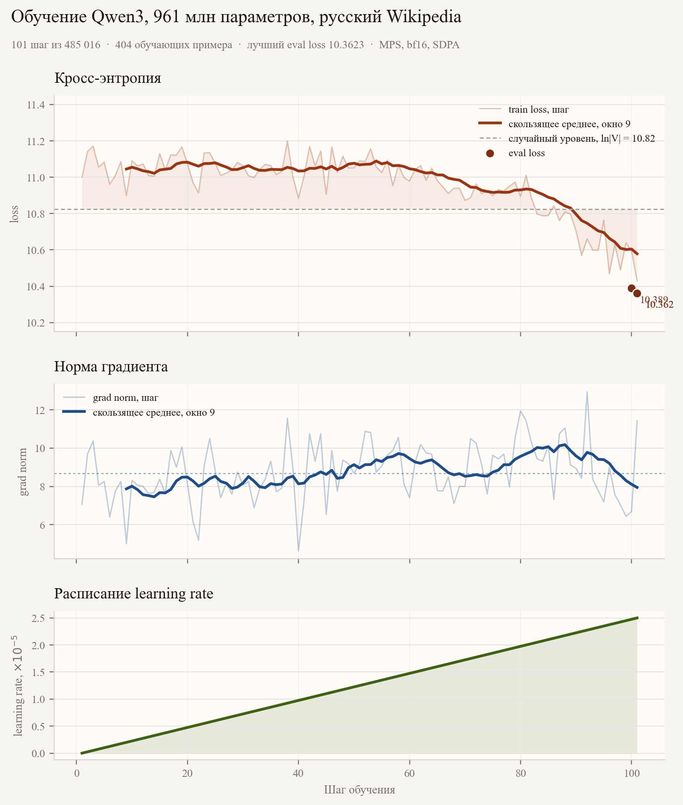

## Описание экспериментов

Проведён один полный обучающий прогон. Архитектура и лимит времени заданы условием и не менялись: Qwen3 на 960 881 664 параметра, 12 слоёв, скрытый размер 2048, 16 голов внимания и 8 KV-голов. Данные - `wikimedia/wikipedia`, конфигурация `20231101.ru`, 1 945 063 статьи. Токенизатор - `ai-forever/rugpt3small_based_on_gpt2`, словарь 50 257 токенов, `pad_token` совпадает с `eos_token`. Контекст обрезается и дополняется до 512 токенов. Валидация - первые 5 000 токенизированных примеров, обучение - оставшиеся 1 940 063.

Сначала обучение не стартовало: `attn_implementation='flash_attention_2'` требует пакет FlashAttention, а он работает только на CUDA. Ноутбук - Apple M4, устройство `mps`, CUDA нет. Реализация внимания заменена на `sdpa`, если CUDA недоступна. Флаг `tf32` оставлен только для CUDA: на MPS он даёт ошибку. Точность `bf16` оставлена, матричные операции в bfloat16 на MPS проходят.

После этого прогнан полный цикл с таймаутом 15 минут чистого обучения. За это время выполнен 101 шаг из 485 016, то есть 404 примера и 0.0208% эпохи. Среднее время шага - около 7 секунд, GPU по `asitop` был занят на 100%. На шаге 100 и на шаге 101 посчитан `eval_loss` на 5 000 примерах, каждая проверка заняла 52–57 минут. Лучший чекпоинт - `output_dir/gpt2-1b-russian/checkpoint-101`.

Отдельный прогон на арендованной CUDA-карте не проводился. По оценке, RTX 4090 с FlashAttention2 дала бы примерно 20–40 раз больше шагов за те же 15 минут. На M4 это ограничение аппаратное: данные уже лежат в parquet, а GPU загружен полностью.

## Гиперпараметры

Пробовал и оставил одну конфигурацию. Менять learning rate, размер батча и warmup на этом железе не было смысла: за 15 минут видно меньше двух сотен шагов, и сравнение расписаний не успело бы проявиться.

| Параметр | Значение | Зачем так |
|---|---|---|
| `learning_rate` | `5e-5` | Верхняя граница линейного warmup |
| `warmup_steps` | `200` | За 101 шаг ставка дошла только до `2.5e-5` |
| `weight_decay` | `0.01` | Стандартный AdamW, без дополнительного поиска |
| `optim` | `adamw_torch_fused` | Сплавленный AdamW |
| `num_train_epochs` | `1` | Эпоха всё равно обрезается таймаутом |
| `per_device_train_batch_size` | `4` | 4 × 512 токенов; больший батч на M4 не влезал бы в память вместе с активациями |
| `gradient_accumulation_steps` | `1` | Эффективный батч равен 4 |
| `gradient_checkpointing` | `False` | Памяти хватило, лишний пересчёт активаций не нужен |
| `max_length` | `512` | Задан условием |
| `bf16` | `True` на MPS и CUDA | Смешанная точность |
| `tf32` | `False` на MPS, `True` на CUDA | TF32 есть только у Ampere и новее |
| `attn_implementation` | `sdpa` на MPS, `flash_attention_2` на CUDA | FlashAttention на Mac не ставится |
| `torch_compile` | `True` | Inductor предупредил, что ускорение рассчитано на Ampere+; первый шаг занял 15.8 с, дальше около 7 с |
| `dataloader_num_workers` | `4` | Чтение parquet не было узким местом |
| `eval_strategy` / `eval_steps` | `steps` / `100` | Валидация попала на последний полный интервал до таймаута |
| `save_steps` / `save_total_limit` | `100` / `2` | Сохранены `checkpoint-100` и `checkpoint-101` |
| `load_best_model_at_end` | `True` | Критерий — `eval_loss`, меньше лучше |
| `logging_steps` | `1` | Каждый шаг попал в `trainer_state.json` |
| Лимит обучения | `900` с | Сработал на 3910 с wall-clock: 15 минут шагов плюс валидация |

## Кривые обучения

На графике три панели: пошаговый train loss со скользящим средним и точками `eval_loss`, норма градиента и линейный warmup. Пунктир на верхней панели — случайный уровень `ln(50257) ≈ 10.82`.

## Финальный eval_loss

**Финальный `eval_loss`: 10.362265586853027.**

Это значение финального `trainer.evaluate()` после загрузки лучшего чекпоинта. Оно совпадает с валидацией шага 101. Промежуточная валидация шага 100 дала 10.388656616210938. Средний train loss за 101 шаг — 10.959178650733268. В `trainer_state.json` лучшая метрика записана как `best_metric = 10.362265586853027`, `best_global_step = 101`.

## Примеры генераций

Модель загружена из чекпоинта `output_dir/gpt2-1b-russian/checkpoint-101`, выставлены параметры `max_new_tokens=48`, `do_sample=True`, `temperature=0.8`, `top_p=0.9`, `repetition_penalty=1.1`, `pad_token_id=tokenizer.pad_token_id`:

> **[In 1]:** Москва — столица

> **[Out 1]:** Москва — столица2014 существо комментирует proteцес Япония сделана опубликованейшие механизuseumдного Людов предполагает спросом Бек генеральный Вот Внешнемолодрешь опубликова белья Богом Получивопределзит ляз ДостаточноСпасибо отвлек российскогорку суматоatre fellowБольше Поверь болен пехот Войдите Европейского жал отпи Поз щуп прикле кроме

> **[In 2]:** Александр Пушкин родился

> **[Out 2]:** Александр Пушкин родилсяьё модуль слетРЕ надеяться Раньше Спу высоте Наконец боеви запрещенырек planned reserv мамынули бур выглядеть полуострове губерна м manufact снизитьолейильярд иконы married заж Saint подсвет Первомай носу Контак существом небольш прикоснуться Навального Illinois Советской долгую Pacific Дне экономическ спар члена необходимаямий бульва

> **[In 3]:** В 1945 году

> **[Out 3]:** В 1945 году октябрь продажам принцип обычно Tam исследователи житель первую ошараетраж назло SpainРТ установленный могла леснойване великоду индустри увлечения следы истинную Бост Шепотропantry анекд внутренний центра арестом followsрела безум historожа Нижнеora эффект складыительочнымиazноза прохяетсяbec titledносит

> **[In 4]:** Российская Федерация

> **[Out 4]:** Российская Федерация переворот Проис направлений укориз Германия centerковой чис;&#amp мечтала штаба зрением людиокуп привело концентрация Линдаовкуеркви рукава ДТП участвует контрат надежные dram мотивации prim турок втори гора идите доступна Едингала 3000600 губу Organ2011 выделяетКазах руководить Эди дизайне Данадал National

## Выводы и наблюдения

1. Обучение на M4 технически дошло до конца пайплайна, но за 15 минут модель почти не сдвинулась от случайного предсказания. Для словаря в 50 257 токенов случайная кросс-энтропия равна `ln(50257) ≈ 10.82`. Train loss начался около 11.0–11.2 и к шагу 101 опустился до 10.43; `eval_loss` равен 10.36. Это меньше случайного уровня, но недостаточно для осмысленной генерации.

2. Узкое место - вычисления, а не данные. GPU был занят на 100%, шаг стабильно занимал около 7 секунд. Предупреждение `pin_memory` на MPS безвредно. `torch.compile` не дал ускорения, на которое рассчитан inductor: первый шаг был даже медленнее, 15.8 секунды.

3. Валидация съела больше времени, чем обучение. Две проверки по 5 000 примеров заняли около 52 и 57 минут, финальная - ещё 57. Wall-clock всего прогона - 7361 секунда, из них обучение до таймаута - 3910 секунд. При таком бюджете `eval_steps=100` слишком частый для M4: полезнее было бы валидировать один раз в конце.

4. Warmup на 200 шагов не успел закончиться. К остановке learning rate был `2.5e-5`, половина от `5e-5`. Норма градиента оставалась в диапазоне примерно 5-13 и не взрывалась, так что оптимизатор вёл себя устойчиво. Сравнивать другие learning rate на 101 шаге нельзя: сигнал слишком короткий.

5. Для этого лимита времени нужен CUDA. FlashAttention2 на M4 недоступен, и 101 шаг не показывает качество архитектуры. На RTX 4090 за те же 15 минут модель увидела бы порядка нескольких тысяч шагов, и тогда имело бы смысл сравнивать learning rate, warmup и размер батча.
